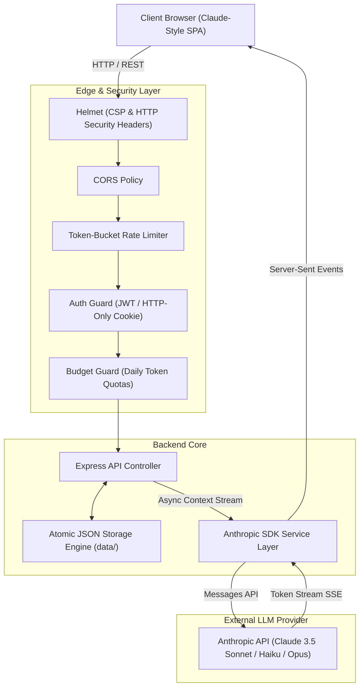

# Enterprise Claude Gateway & Workplace Assistant

[](https://nodejs.org/)
[](https://docs.anthropic.com/)
[](https://opensource.org/licenses/MIT)
[](https://helmetjs.github.io/)

A production-grade, self-hosted enterprise AI assistant platform built on Node.js, Express, and the official Anthropic Claude SDK. Engineered to solve the primary challenges of deploying Large Language Models (LLMs) in corporate environments: **data confidentiality**, **financial cost governance**, **token abuse prevention**, and **granular multi-user access control**.

---

## Architecture Overview



---

## Key Engineering Highlights

### 1. High-Performance Token Streaming (Server-Sent Events)
- **Protocol Decision**: Utilizes unidirectional **Server-Sent Events (SSE)** rather than bidirectional WebSockets, reducing connection overhead and operating seamlessly behind corporate firewalls and HTTP/2 proxies.
- **Client Cancellation Handling**: Integrates `AbortController` bound to the client's HTTP request `close` event. When a user clicks **Stop** or navigates away, the backend immediately terminates the upstream Anthropic API stream, saving tokens and compute.
- **Sliding Context Window**: Automatically maintains a rolling 20-message conversational memory buffer, preventing token bloat while preserving conversation context.

### 2. Financial Governance & Cost Controls
- **Denial-of-Wallet (DoW) Defense**: LLM APIs bill per token. To eliminate risk of massive unauthorized bills:
  - **Payload Ceiling**: Rejects prompts exceeding 50,000 characters before reaching the API layer.
  - **Per-User Daily Quotas**: Enforces configurable daily token caps (default `150,000 tokens/user/day`).
  - **Token Bucket Rate Limiting**: Restricts burst requests (`60 req / 15 min`) to block script loops.
- **Token Telemetry**: Captures exact `prompt_tokens` and `completion_tokens` returned in Anthropic's response headers, feeding real-time quota gauges and the Admin Analytics dashboard.

### 3. Enterprise Security & Compliance
- **Zero API Key Leakage**: The Anthropic API key is strictly isolated in server-side environment variables and is never exposed to client-side runtimes.
- **Strict Content Security Policy (CSP)**: Hardened via Helmet to prevent clickjacking, MIME-type sniffing, and unauthorized resource injection.
- **XSS-Safe Dynamic Markdown**: AI responses are rendered into HTML via `marked.js` and scrubbed through **DOMPurify** before DOM insertion to mitigate indirect prompt injection attacks.
- **Stateless Authentication**: Uses signed JWTs stored in **HTTP-only, SameSite=Lax** cookies, securing sessions against cross-site scripting and credential interception.
- **Corporate Gatekeeping**: Supports domain whitelisting (`ALLOWED_EMAIL_DOMAINS=yourcompany.com`) and team invite passcodes.

### 4. Zero-Dependency Atomic Data Persistence
- Built with an **ACID-inspired atomic swap file system** (`fs.renameSync` via temporary buffers) for local data storage (`data/*.json`).
- Prevents database corruption from unhandled process termination or concurrent write contention, completely eliminating the need for external database infrastructure for small-to-medium teams.

---

## Feature Matrix

| Feature | Implementation | Engineering Benefit |
| :--- | :--- | :--- |
| **Model Switching** | Claude 3.5 Sonnet, 3.5 Haiku, 3 Opus | Matches workload requirements (coding vs rapid summaries) |
| **Streaming UI** | SSE + Token Parser + Dynamic Pulse Cursor | Low-latency perceived response time (< 500ms) |
| **Code Highlighting** | Highlight.js with Atom Dark theme + 1-Click Copy | Developer-friendly workspace |
| **Custom Personas** | System Prompt Drawer (Senior Dev, Executive, Analyst) | Task-tailored output formatting |
| **Export Engine** | Client-side Markdown Blob generator | Offline record keeping & documentation |
| **Theme System** | Dual Theme Engine (Claude Ivory Light / Obsidian Dark) | Accessible, eye-strain-reducing interface |
| **Admin Analytics** | Real-time colleague token telemetry | Visibility into cost drivers and usage frequency |

---

## Quickstart

### Prerequisites
- Node.js >= 18.0.0
- npm >= 9.0.0
- Anthropic API Key ([Anthropic Console](https://console.anthropic.com/))

### 1. Installation
```bash
git clone https://github.com/YOUR_USERNAME/enterprise-claude-gateway.git
cd enterprise-claude-gateway
npm install
```

### 2. Environment Configuration
Create a local `.env` file from the provided template:
```bash
cp .env.example .env
```

Configure your credentials:
```env
PORT=3000
ANTHROPIC_API_KEY=sk-ant-api03-...
JWT_SECRET=generate_a_random_32_character_secret_here
TEAM_ACCESS_CODE=YourOfficeInviteCode2025
ALLOWED_EMAIL_DOMAINS=*
DEFAULT_MODEL=claude-3-5-sonnet-20241022
MAX_TOKENS_PER_REQUEST=4096
DAILY_USER_TOKEN_LIMIT=150000
```

### 3. Execution
```bash
# Production start
npm start

# Development mode with hot-reloading
npm run dev

# Run automated unit & integration test suite
npm test
```

Navigate to `http://localhost:3000` in your browser.

---

## API Specification

| Method | Endpoint | Access | Description |
| :--- | :--- | :--- | :--- |
| `POST` | `/api/auth/register` | Public (Rate-Limited) | Register with company email, password, and invite code |
| `POST` | `/api/auth/login` | Public (Rate-Limited) | Authenticate user and issue secure HTTP-only cookie |
| `POST` | `/api/auth/logout` | Authenticated | Invalidate session cookie |
| `GET` | `/api/auth/me` | Authenticated | Retrieve user profile & daily token quota status |
| `GET` | `/api/models` | Authenticated | Retrieve supported Claude models and metadata |
| `GET` | `/api/chats` | Authenticated | List user conversations sorted by update time |
| `POST` | `/api/chats` | Authenticated | Create a new conversation thread |
| `POST` | `/api/chat/stream` | Authenticated (Rate-Limited) | Server-Sent Events stream for AI completion |
| `GET` | `/api/admin/stats` | Admin Only | Telemetry dashboard with per-user token consumption |
| `GET` | `/api/health` | Public | Service health & configuration status check |

---

## Project Structure

```
├── .env.example              # Environment variable specification template
├── .gitignore                # Protects .env, node_modules, and local data
├── package.json              # Project dependencies and lifecycle scripts
├── server.js                 # Express server, route orchestration, and SSE pipeline
├── middleware/
│   ├── auth.js               # JWT verification & role-based access control (RBAC)
│   └── rateLimiter.js        # IP/User rate limiters and daily token budget filter
├── services/
│   ├── anthropicService.js   # Anthropic SDK client, prompt formatter & streaming engine
│   └── dbService.js          # Atomic file-system JSON persistence layer
└── public/                   # Frontend SPA
    ├── index.html            # Semantic HTML5 layout & modal templates
    ├── css/style.css         # Custom responsive design system & themes
    └── js/app.js             # Client state manager, SSE parser, and DOM renderer
```

---

## Author

**Srikanth P V**
- GitHub: [@Srikanthpv21](https://github.com/Srikanthpv21)

## License

This project is licensed under the MIT License - see the LICENSE file for details.
